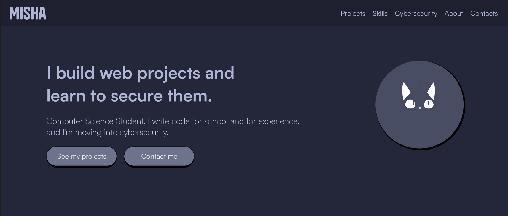

# Portfolio

Misha | CS Student - Cybersecurity & Web Development

Personal portfolio website, built with plain HTML, CSS, and vanilla JavaScript.

## Features

- Custom dark theme based on the Catppuccin Macchiato palette
- Typography pairing using Tanker and Satoshi
- Fully responsive layout built without external frameworks

## Stack

- HTML5 / CSS3 / Vanilla JavaScript
- Hosted on GitHub Pages

## License

See [LICENSE](LICENSE).
